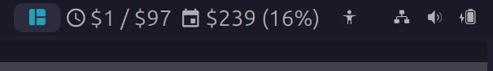

# litellm-cost-waybar

LiteLLM spend indicator for Waybar.

Displays today's and month-to-date spend against configurable budgets. The
Waybar tooltip includes the totals and percentage used.



## Install

Clone the repository, then install it from the project directory:

```bash
uv tool install .
```

This installs the `litellm-cost` command.

## Configure

Set your LiteLLM base URL and budgets. `--key` opens a hidden prompt for your
API key:

```bash
litellm-cost config \
  --url https://litellm.example.com \
  --key \
  --daily-limit 10 \
  --monthly-limit 200
```

Configuration, including the API key, is stored as plain text in
`~/.config/litellm-cost/config.yaml`. File permissions are set to `0600`,
restricting access to your user. The LiteLLM URL must use HTTPS; the API key is
sent as a Bearer token.

To show an optional estimate of the amount available per remaining weekday,
enable `--remaining-budget`:

```bash
litellm-cost config --remaining-budget
```

Use `--no-remaining-budget` to turn it off. Weekends are excluded from the
estimate.

## Configure Waybar

Add the module to your Waybar config and include it in `modules-right` (or
another module list):

```jsonc
{
  "modules-right": ["custom/litellm-cost"],
  "custom/litellm-cost": {
    "exec": "litellm-cost waybar",
    "return-type": "json",
    "interval": 60,
    "tooltip": true
  }
}
```

The module reports a status class based on the higher of the daily and monthly
budget percentages: `normal` below 80%, `warning` from 80%, and `critical` at
100% or more. Request or configuration errors use the `error` class.

Optional colors are provided in [waybar.css](waybar.css). Copy the rules into
your Waybar stylesheet to style each status class.

## License

[BSD 3-Clause](LICENSE).
